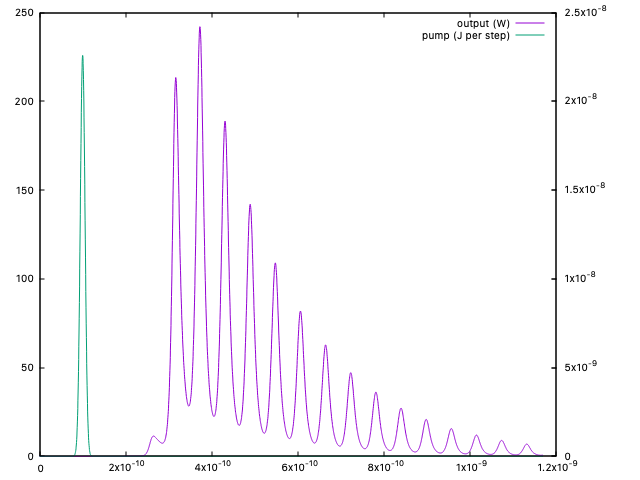
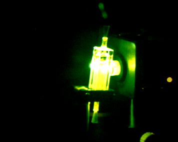

# Laser Cavity Dynamics
A one-dimensional, time-dependent simulation of a short laser cavity with a
spatially inhomogeneous gain medium. The C++17 core has no third-party
dependencies and can be used independently of the command-line interface.

<p align="center">
    
</p>

## Introduction
I created the original version of this programme during my master's thesis research project within the Quantum Optics group of Molecular Physics, Faculty of Science and Mathematics at the University of Leiden in 1999. It was based on a program created by Dr S.A. (Steven) van den Berg who supervised my work as a PhD-student at the time. I applied a slighty different implementation using the coupled cavity-atom rate equations as formulated by Siegman<sup>1</sup>.

<p align="center">
    
</p>

At the time we were researching fundamental optical properties of a PPV-derivative organic semiconductor material and the phenomenon of "transient gain", i.e. laser gain that seems to disappear without conforming to standard laser rate equations. We quickly discovered that a small (1.5 cm) cavity of the material in solution produced pronounced spikes in the output. Although I credit myself with being the first to see the unusual measurements, it was Steven that did the work of figuring out the dynamics involved. He published a [paper](https://opg.optica.org/ol/viewmedia.cfm?uri=ol-24-24-1847) on the results in _Optics Letters_ <sup>2</sup>.

### References
1. A.E. Siegman, Lasers, University Science Books (1986)
2. S.A. van den Berg, R.H. van Schoonderwoerd den Bezemer, H.F.M. Schoo, G.W. ’t
Hooft and E.R. Eliel, Opt. Lett. 24, 1847 (1999)

## Build

```sh
cmake -S . -B build
cmake --build build
ctest --test-dir build --output-on-failure
```

The tests are split by area (`io`, `components`, `simulator`) plus one CTest test per
validation case from CONTEXT.md (`validation.*`). Run a single case directly, for example
`build/cavdyn-validation convergence`.

## Run

Generate a starter configuration and run it:

```sh
build/cavity-dynamics defaults > config.txt
build/cavity-dynamics run config.txt -o output.dat
```

The defaults are defined once, in `include/cavdyn/Parameters.h`; `defaults` prints them.
A configuration file only overrides: any key it leaves out keeps its default, so a file
can be as short as

```ini
[gain_medium]
lifetime = 1e-10
```

The simulation writes tab-separated time-series data suitable for gnuplot,
Origin, or Python. If snapshots are enabled in the configuration, a companion
`output.snapshots.dat` file contains the spatial profiles. All parameters use
SI units; see [CONTEXT.md](CONTEXT.md) for the physical model and parameter
definitions.

## View Output

To view the output, you can use `gnuplot`:

### output.dat
```sh
brew install gnuplot
gnuplot -p -e "set xlabel 'time (ns)'; set y2tics; plot 'output.dat' u 1:2 w l t 'output photons', '' u 1:6 axes x1y2 w l t 'pump energy (J)'"
```
This shows the pump pulse and the output photons (modify for `initial_inversion` or `power` simulations).

Or use the `gnuplot` scripts:
```sh
gnuplot -p ./gp-scripts/plot-stacked.gp
gnuplot -p ./gp-scripts/plot-log.gp
```
These show the number of output photons, the inversion and the pump energy as a) a stacked graph and b) a log plot in one graph.

### output.snapshot.dat
Enabling snapshots (by setting the `snapshot_interval` parameter in `config.txt` to a nonzero value) stores snapshots of the energy and inversion _inside_ the cavity. One roundtrip is equivalent to 280 steps, so to get a smooth animation an interval of 5 or less is recommended. Note: at interval 1 the resulting file is 26.8 MB.
```sh
gnuplot -p ./gp-scripts/snapshot-animation.gp
gnuplot -p ./gp-scripts/snapshot-heatmap.gp
gnuplot -p ./gp-scripts/snapshot-medium-inversion-heatmap.gp
```
The heatmaps show the inversion as a function of time (y-axis), one for the total cavity on a linear color scale and one for the gain medium on a log colour scale.
